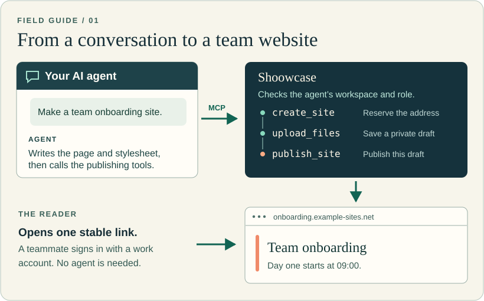
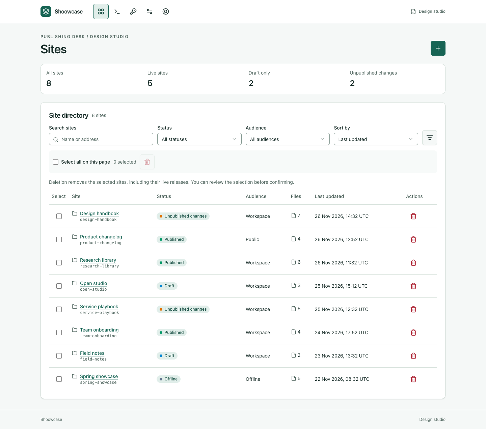
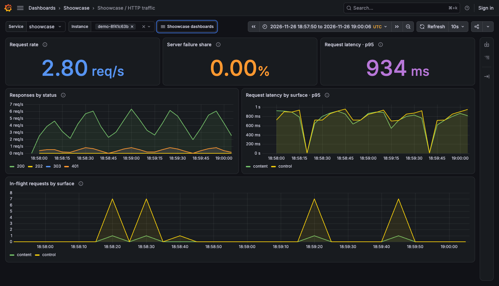

# Shoowcase

**Give your AI agent one MCP connection. Ask it to make a website.** Shoowcase saves the files, gives you a private preview and hosts the version you publish. A teammate opens an ordinary link. A week later, a different agent can find the same site and update it without the original chat.

[](https://github.com/openhoo/shoowcase/actions/workflows/ci.yml) · [Download a release](https://github.com/openhoo/shoowcase/releases) · [Run it for your team](docs/operations.md) · [Apache-2.0](LICENSE)

Shoowcase is a **self-hosted website platform** for onboarding guides, project updates, handbooks and other small team sites. Write pages with your existing agent, or create them yourself in the browser. One Go service hosts them all, with no model call, build job or separate process per site. The software is public; the sites you create start private to your workspace.

## From chat to a website

<picture>
  <source media="(max-width: 650px)" srcset="docs/media/chat-to-site-mobile.svg">
  
</picture>

1. **Ask in chat.** “Make a team onboarding site with our first-day checklist. Give me a private preview.” Through the Model Context Protocol (MCP), the agent creates the site and uploads its HTML, CSS and images.
2. **Review and publish.** Open the preview. Ask for edits or say, “Publish this revision for my workspace.” Coworkers can now sign in at the stable site address; they don’t need an agent.
3. **Return in a fresh chat.** “Find the onboarding site. Change the start time to 10:00 and show me the draft.” The agent reads the files from Shoowcase. The live site stays as it was until you publish again.

## Get started

### My team already runs Shoowcase

1. Open your team’s Shoowcase address and choose **Create an account**. Sign in through your organization and choose a display name. Your work identity determines which workspace you join. If you see **Workspace access required**, give your workspace administrator the sign-in ID shown there, then reload after they add you.
2. Open **Agent keys → Create a key**. Choose **Editor** for creating and updating drafts, or **Publisher** if the agent should also publish releases. A new key defaults to read-only access and expires after the period you choose.
3. In your agent’s settings, add the **Streamable HTTP** MCP server URL shown on the receipt. Store the key as a bearer token in the client’s credential settings. Copy it before leaving the page; never paste it into your chat or site. If your client uses your organization’s configured OAuth sign-in, you can connect without a personal key.
4. Ask your agent to list your sites. It can discover the publishing tools from the server. The optional [publishing skill](skills/shoowcase-publish/SKILL.md) teaches it when to use each one.

Try: **“Create a site called Team Fieldnotes. Make a welcome page and a checklist, publish them for my workspace, and give me the URL.”** To try it with ready-made files, use the [onboarding example](examples/onboarding/).

### I want to try it on my computer

[Download an archive](https://github.com/openhoo/shoowcase/releases) for macOS (Apple silicon), Linux (amd64/arm64) or Windows (amd64), [verify it](deploy/README.md), extract it, and run `./shoowcase -dev` (Windows PowerShell: `.\shoowcase.exe -dev`). Or build from source with Git, Make and Go 1.26 or later:

```sh
git clone https://github.com/openhoo/shoowcase.git
cd shoowcase
make build
./bin/shoowcase -dev
```

Open **http://localhost:7878** and choose **Create an account** to enter the local workspace. Leave the server running. In a second terminal, `curl -fsS http://localhost:7878/readyz` should print `ready`.

| Local client setting | Value |
| --- | --- |
| Transport | Streamable HTTP |
| Server URL | `http://localhost:7878/mcp` |
| Authentication | Bearer token. Load the value from `.shoowcase/agent-token` into your client's secret store. Keep it out of chat and source control. |

Development mode uses SQLite in `.shoowcase/`, signs local browsers in as one test user, and serves sites under `*.localhost:7878`. The agent’s MCP client must run on the same computer. A cloud agent needs a reachable [production HTTPS deployment](docs/operations.md); keep the development server on loopback.

## Publish from your browser

Open **Sites** to see your workspace’s publishing desk. Search by site name or address, filter by status and audience, and sort by last update or name. Each row shows the file count, when the site changed, and whether the draft differs from the published release.

Choose **New site**, give it a name, choose its budget group if prompted, and select **Create site**. Then choose how to add your first draft:

| In the workspace | What it does |
| --- | --- |
| **New file** | Write `index.html`, local CSS or JavaScript in the editor. Select an existing text file to edit it. |
| **Upload file** | Add one file or replace a path in the draft, including a raster image. |
| **Import ZIP** | Import a folder of site files as one revision. Include `index.html` at the root or in a single enclosing folder. A rejected file leaves the whole draft unchanged. Unmentioned files stay in place. |

Choose **Preview draft**. When you’re ready, choose **Publish draft**. Use **Access** to manage who can open the live link and **Releases** to restore a previous version. The browser and the agent share the same draft, revision history and permissions.

<picture>
  <source media="(max-width: 520px)" srcset="docs/media/workspace-mobile.png">
  
</picture>

### Give a project a budget

Open **Workspace admin → Quotas** to see how many sites each group owns and how much storage its saved revisions use. For example, give the **Onboarding** group **5 sites and 250 MiB**. Its sixth site or an edit that would exceed 250 MiB is refused in both the browser and MCP. All groups also share the workspace limit. You can assign an existing site to a group with its full history. See [Set project budgets](docs/tenant-access.md#set-project-budgets) for setup and upgrade behavior.

### A small interactive app

Try the [workshop tally](examples/counter/): import the three files and click **Add one** in the preview. A local `app.js` can respond to clicks and input, read a field and update text. It runs inside a browser worker with a separate JavaScript interpreter. It has no access to the network, cookies, browser storage, page navigation or the management console. Plain sites load no JavaScript runtime. [Supported DOM methods and limits →](runtime/README.md)

## Draft, release and audience

| Concept | What it controls |
| --- | --- |
| **Draft** | Uploading files creates a new immutable revision. Each revision has its own workspace-only preview. Unmentioned files stay in place. |
| **Release** | Publishing points the stable address at an exact revision. Rolling back restores a previous release while preserving the draft, address and audience. |
| **Audience** | **Workspace** requires a work sign-in. **Public** lets anyone with the address read the site. **Offline** withdraws the live site and preserves its history. |

Public sharing is disabled by default. If an operator enables it, making a site public, publishing a new public release or rolling a public site back requires a publisher to review the exact change in their browser. Merely opening the review link does not grant access. Making a site private blocks new anonymous reads. Taking it offline also blocks signed-in reads at the live address. Neither action can recall a downloaded copy.

## What the agent can do

| MCP tool | Use it to… |
| --- | --- |
| `create_site` | Reserve an address and start an unpublished workspace site. |
| `list_site_groups` | Find the groups this credential can charge when creating a site; pass the chosen ID as `group_id` to `create_site`. |
| `list_sites` | Find sites the workspace can access, including ones made in another chat. |
| `get_site` | Inspect the draft, a selected revision, a single file or paginated release history. |
| `upload_files` | Add, replace or explicitly delete draft files against an expected revision. |
| `prepare_upload` | Get a five-minute link for one file of a specified size and SHA-256 digest. Upload exact bytes or let a person choose the file in a browser. |
| `publish_site` | Make the named current draft revision live at the stable address. |
| `set_site_access` | Change the audience of the live site. |
| `rollback_site` | Restore a prior release while checking that the expected release is still live. |

Agents reuse the same request ID and arguments when retrying a mutation. A stale revision returns a conflict so an agent can read the current draft before changing anyone else’s work. A completed mutation returns its original receipt; `get_site` reports current state.

**Content:** HTML, CSS, local JavaScript, PNG, JPEG and GIF. A revision holds up to **100 files / 8 MiB**; each text file is limited to **256 KiB**, each image to **2 MiB**. You can host an interactive checklist or calculator. Apps that need a backend, arbitrary browser APIs, external packages at runtime or a full browser DOM require a different host.

## Run it for an organization

The **control host** handles MCP, sign-in, uploads and human approvals. **Site and preview hosts** live on a separate registrable domain with wildcard DNS and TLS. **PostgreSQL** stores file bytes, manifests, releases, audit events and retry records. Replicas share the database and signing key. A signed claim selects the workspace. The identity provider sets the maximum role; the workspace can further restrict access.

| Role | Permissions |
| --- | --- |
| Viewer | Read workspace sites and private previews. |
| Editor | Also create sites and edit drafts. |
| Publisher | Also publish, roll back, change the audience and approve public releases. |
| Admin | Also manage enrolled workspace members and their agent keys, review workspace audit history and manage groups. Process metrics are available only to administrators of an explicitly configured operator workspace. |

In **Admin**, a workspace administrator can add members, manage groups, set role limits, suspend members and revoke keys. In [managed mode](docs/tenant-access.md), members start as viewers and receive editor or publisher rights through group membership. Suspension revokes the member’s keys; restoring the member does not reactivate them. Administrators are assigned through the identity provider.

See [OIDC and PKCE configuration](docs/oidc.md) and [audit export and retention](docs/audit.md).

Start with [deployment and identity setup](docs/operations.md) and the [container configuration](deploy/compose.yaml). Before accepting company traffic, test your real identity provider and agent client, cross-workspace access, withdrawal and a [restore into a separate database](docs/restore-drill.md). The [verification report](docs/verification.md) and [HTTP measurements](docs/http-benchmark.md) show what was tested and under what conditions.

### Monitor Shoowcase with Grafana

Three dashboards show HTTP service health, MCP tool outcomes and database connection pools. Switch between them with the same time range and replica selection. Open the [illustrated Grafana guide](docs/grafana.md) to run the local example, install the dashboards in an existing Grafana, or add one of your own. For traces and logs, see [OpenTelemetry configuration](docs/telemetry.md).

[](docs/grafana.md)

## Skills and project guide

| For | Start here |
| --- | --- |
| An agent publishing sites | [Publishing skill](skills/shoowcase-publish/SKILL.md) — author, preview, publish, recover a site in a fresh chat and handle conflicts. |
| An agent changing or operating Shoowcase | [Engineering and operations skill](skills/shoowcase-operate/SKILL.md) — code ownership, isolation checks, storage changes and release evidence. |
| A maintainer or evaluator | [Product scope and roadmap](docs/design.md) · [Security model and reporting](SECURITY.md) · [Contributing](CONTRIBUTING.md) · [Repository instructions](AGENTS.md) |

To install a skill, download the **skills ZIP** from [Releases](https://github.com/openhoo/shoowcase/releases), [verify the archive](deploy/README.md), then copy the desired skill directory into your agent’s skills directory. Both skills are also in the tagged source tree. The server enforces permissions whether or not a skill is installed. Shoowcase’s code, artwork and both skills are licensed under [Apache-2.0](LICENSE). The bundled interpreter includes [third-party MIT-licensed code](runtime/THIRD-PARTY-LICENSES.txt).
