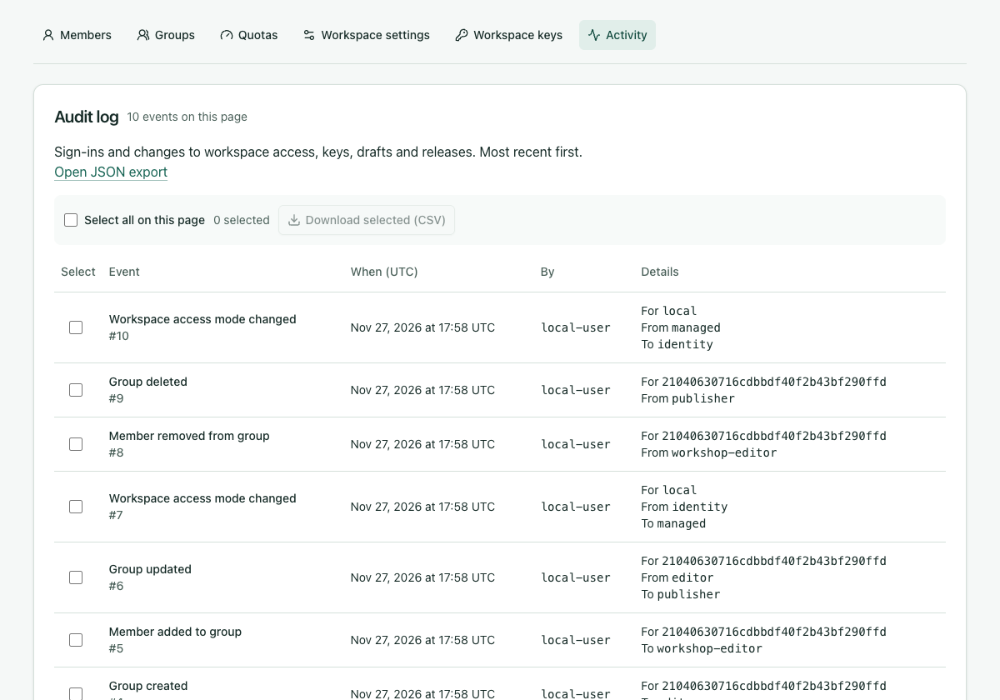

# Workspace audit log

Open **Admin → Activity** to see the newest events and page back through history. This log belongs to one workspace. It contains stable identities and resource IDs and is intended for its administrators. To download a subset of the current page, check its rows and choose **Download selected (CSV)**. For a complete export, use the paginated JSON API described below.

## What is recorded

| Event | Details |
| --- | --- |
| Browser sign-in and sign-out | Verified subject, workspace and time. A sign-in means authentication succeeded; it does not grant membership in a managed workspace. |
| Account, group and policy changes | Actor, action, target and changed role, mode or member subject where applicable. Suspension revokes the member's keys. Names and form text are not copied into the ledger. |
| Key issuance and revocation | Public key ID and, on issuance, its scope. Credentials and their digests are never included. |
| Quota and site assignment changes | Previous and new site/storage limits for the workspace or group; previous and new budget group IDs when a site moves. |
| Site mutations | Tool, site ID, configured audience, draft revision, live revision and release ID. For a personal key, the event identifies both its owner and public key ID. A successful retry of the same mutation adds no event. |
| Selected authorization denials | Verified user denied access to the admin console or audit export, or denied a site tool by policy. Stores a fixed operation name. Up to six such events per actor and 60 per workspace per minute per replica; metrics report denials independently. |

Successful domain writes and their audit entries share a transaction: a failed audit insertion rolls back the change. The database serializes changes within a workspace and assigns a local sequence number in commit order. Anonymous reads and malformed sign-in attempts do not create records in an arbitrarily supplied workspace. Application and collector logs are separate from this history.

## Export to a protected destination

Use `GET /api/audit?after=0` on the control host with an enrolled workspace administrator's browser session or IdP OAuth access token. Personal agent keys cannot read the export. The server derives the workspace from the verified identity. There is no tenant selector.

The response contains a JSON array in `events`, `next_after` and `has_more`. Events are in ascending sequence order; at most 200 are returned. Write them to the destination, then persist `next_after` as the checkpoint for that workspace. Request the next page immediately when `has_more` is true; otherwise poll later with the same checkpoint. An empty page retains the checkpoint. Deduplicate retries by workspace and sequence.

The application does not expire ledger rows. Schema 3 imports existing site history and whatever entries remain in the older bounded account feed. Events already discarded before the upgrade cannot be reconstructed. Monitor database capacity and protect backups. Database owners can change or restore history; for independent retention use a separate destination with restricted deletion rights. After point-in-time recovery, reconcile the restored ledger with the archive **before** resuming ingestion: a restored database can rewind and reuse sequence numbers. Retain both histories and start a new export epoch when they diverge.
