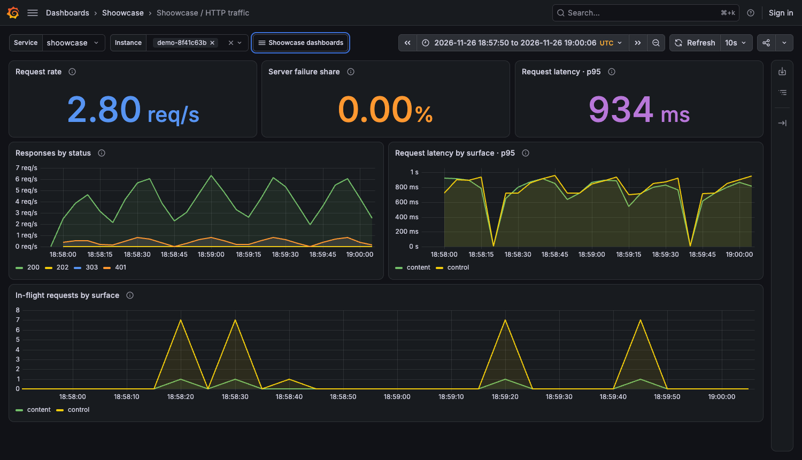
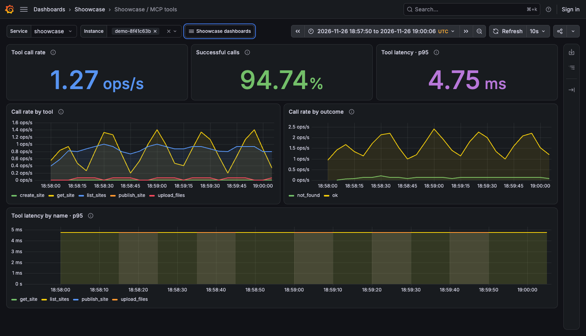
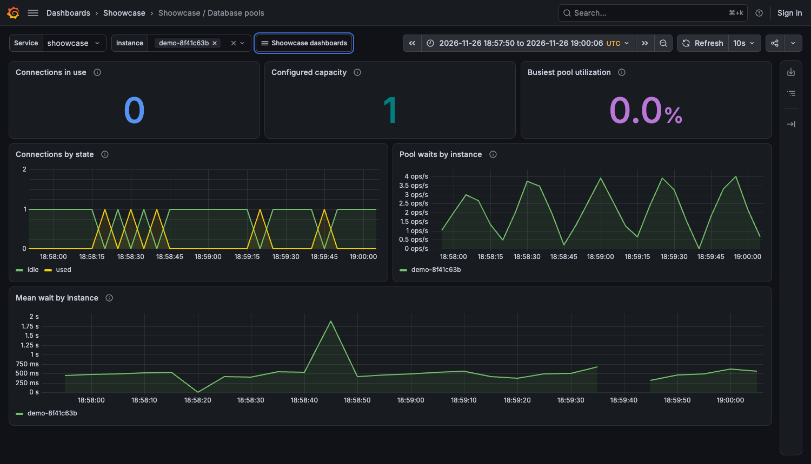

# Grafana dashboards

Open **Dashboards → Shoowcase** in Grafana. Start with **Shoowcase / HTTP traffic** when the service feels slow, **Shoowcase / MCP tools** when an agent call fails, and **Shoowcase / Database pools** when requests appear to wait on storage. Each dashboard can show one service instance or aggregate its replicas. Use the **Shoowcase dashboards** menu to switch views while keeping the time range and selected replicas. These are operator views: there is no tenant selector or user activity feed. Workspace administrators can find that information in [Admin → Activity](audit.md).

| Local dashboard (after startup) | First question |
| --- | --- |
| [HTTP traffic](http://127.0.0.1:13000/d/shoowcase-http/shoowcase-http-traffic) | Are requests failing or slowing down? |
| [MCP tools](http://127.0.0.1:13000/d/shoowcase-mcp/shoowcase-mcp-tools) | Which tools and outcomes explain the change? |
| [Database pools](http://127.0.0.1:13000/d/shoowcase-db/shoowcase-database-pools) | Is one replica waiting on database connections? |

## Open the dashboards locally

From the repository root, with Docker Compose and Python 3 installed:

```sh
python3 scripts/observability.py up
```

Open **[Grafana on localhost](http://127.0.0.1:13000)**. No login is required for the local Viewer. The launcher provisions Grafana, Prometheus and a metrics-only OpenTelemetry Collector. It does not start Shoowcase or change an existing installation. Choose one way to supply data:

- **Explore a worked example.** With Go, Chrome and `uv` installed, run the commands below. The capture script starts its own temporary Shoowcase process and database, exercises both HTTP and MCP and opens all three dashboards in Chrome. It checks the results before writing the screenshots. Allow a few minutes for traffic and scrapes.

  ```sh
  make build
  uv run scripts/capture-grafana.py --output ./dist/grafana-example
  ```

- **Follow your own local instance.** Start it with the settings below. The metrics endpoint is a full OTLP/HTTP URL. Open Shoowcase and use a site or make an MCP tool call. Allow several five-second scrapes for rates and percentiles to appear. The example leaves traces and logs unconfigured; an existing deployment can send those signals to its own backends.

  ```sh
  make build
  OTEL_EXPORTER_OTLP_METRICS_ENDPOINT=http://127.0.0.1:24318/v1/metrics \
  OTEL_METRIC_EXPORT_INTERVAL=5000 \
  OTEL_SERVICE_NAME=shoowcase \
  ./bin/shoowcase -dev
  ```

The local ports are **13000** (Grafana), **19090** (Prometheus) and **24318** (OTLP/HTTP). Override them with `SHOOWCASE_GRAFANA_PORT`, `SHOOWCASE_PROMETHEUS_PORT` and `SHOOWCASE_OTLP_PORT` before starting the stack; use the same ports for the producer and capture script. To inspect or stop this disposable stack:

```sh
python3 scripts/observability.py status
python3 scripts/observability.py down
```

Stopping removes its ephemeral metrics and Grafana state. The dashboard definitions and captured images remain in the repository.

The launcher also supports Podman Compose: append `--engine podman` to each `up`, `status` and `down` command. On Windows, use WSL for the generated Grafana admin credential.

## Read the panels

The screenshots below are from Grafana rendering real measurements from a disposable Shoowcase instance. The workload and identities are synthetic; the values are examples, not a performance baseline.

### HTTP service health

Use request rate, server-error share and p95 latency together. A spike in p95 with stable traffic is different from the same spike during a burst. Split by control versus content surface to see which side is affected. Auth denials (401/403) are visible in the status breakdown; interrupted requests count as server errors even when no HTTP status was sent. With no requests, a ratio or percentile has no meaningful value.



The HTTP capture has no server failures. Its 401 responses came from requests with no credentials; they are counted separately from server errors.

### MCP tool operations

Start here if a client received HTTP 200 but a tool did not complete. The success percentage uses the tool result. Compare calls by tool with the outcome breakdown: a conflict may mean the caller needs a fresh revision, while an internal failure points to the service. Percentiles come from duration buckets; they are estimates.



The example deliberately asks for a missing site. That produces the `not_found` tool outcome shown above even though the HTTP transport completed successfully.

### Database connection pools

The busiest pool shows the utilization of the most occupied replica. A fleet total can hide one saturated pool. Look for rising waits and time per wait on the same instance before changing the pool size. A wait measures time to acquire a database connection, not the time spent executing SQL. The example uses the local SQLite pool, which has a limit of one connection; production PostgreSQL can show different behavior.



The occupancy stat shows the last sample. The lower charts show when the fixture occupied the connection and how long other requests waited for it. A gap in mean wait means there were no observed waits in that interval.

## Use an existing Grafana and Prometheus

1. Send Shoowcase **metrics** to your Collector. The dashboards query Prometheus, not the application's legacy `/metrics` endpoint. The reference [Collector](../deploy/observability/collector.yaml) translates OTel names with underscores and unit/type suffixes. The [Prometheus scrape configuration](../deploy/observability/prometheus.yaml) preserves the exported `job` (service) and `instance` (replica) labels. The dashboards also select the instrumentation scope `otel_scope_name="github.com/openhoo/shoowcase"` so a shared backend does not mix in another HTTP library. An alternative ingestion pipeline must expose equivalent names and labels.
2. Provision your Prometheus data source with UID `shoowcase-prometheus`, or change the UID in the dashboard JSON files, including the variable definitions, to match an existing data source. Use your own Prometheus URL and set its scrape interval accurately; the rate panels use Grafana's `$__rate_interval`. Do not replace the default data source in a shared organization just to install these dashboards.
3. Copy the [dashboard JSON files](../deploy/observability/dashboards/) to a Grafana-readable directory. Install the [file provider](../deploy/observability/grafana/provisioning/dashboards/shoowcase.yaml) in your dashboard provisioning directory and set `options.path` to the mounted JSON directory. The local provider polls every 15 seconds. For a one-off import, use **Dashboards → New → Import** and upload each JSON after mapping the data source UID. Select the target folder in the import screen. Check for existing matching UIDs before importing or provisioning into a shared organization.
4. Open the Shoowcase folder, select the service and replica, and check a known request and tool call. Use your Grafana access controls to grant operators read access. For shared or production use, supply authenticated ingress, protected metric ingestion and your own persistence and retention. The local anonymous viewer and in-memory storage are for loopback use.

**Add a dashboard:** Save its classic dashboard JSON in the mounted directory with a unique, stable UID and a unique title in the folder. Tag it `shoowcase` to include it in the dashboard switcher, and copy the existing dashboard link to navigate back. Use the same Prometheus data source and service/instance filters. The provider picks up the file without an app release. Edit the files in Git; the provided dashboards are read-only in Grafana. To ship another illustrated dashboard, extend the [capture script](../scripts/capture-grafana.py) and add its screenshot and operator question here.

## Check a dashboard change

Run `python3 scripts/check-grafana.py` to evaluate the queries from the actual dashboard JSON with the pinned Prometheus `promtool`. The fixture covers an idle service, all-success and all-denied calls, weighted percentiles, multiple replicas and a waiting connection pool. A local `promtool` binary can also be supplied with `--promtool /path/to/promtool`.

To refresh the images in this guide after a panel change, start the local stack, run `make build`, then `uv run scripts/capture-grafana.py` with no output override. It writes only the three Grafana PNGs under [docs/media/grafana](media/grafana/). Review the images along with the JSON change.

## If a panel is empty

| What you see | What to check |
| --- | --- |
| No Shoowcase dashboards in the folder | Confirm that the JSON directory is mounted at the provider’s `options.path`. Check Grafana startup/provisioning logs for duplicate UIDs or invalid JSON. |
| Dashboards exist, but every panel is empty | In [local Prometheus targets](http://127.0.0.1:19090/targets), check that the Collector scrape is up. Then query `http_server_request_duration_seconds_count` after requesting a page. An up scrape alone does not prove Shoowcase exported data. Inspect `job` and `instance` and select the same values in Grafana. |
| HTTP data appears, MCP is empty | Make a registered MCP tool call. Authentication failures before dispatch show up as HTTP responses; they cannot produce a tool-duration observation. |
| Pool waits or a percentage has no value | A pool can have no waits and an idle service can have no requests in the window. Increase the time range or generate traffic before treating an empty ratio as a failure. |

See [OpenTelemetry configuration](telemetry.md) for TLS, sampling, signal privacy and export intervals, and Grafana’s [provisioning reference](https://grafana.com/docs/grafana/latest/administration/provisioning/) for provider options.
