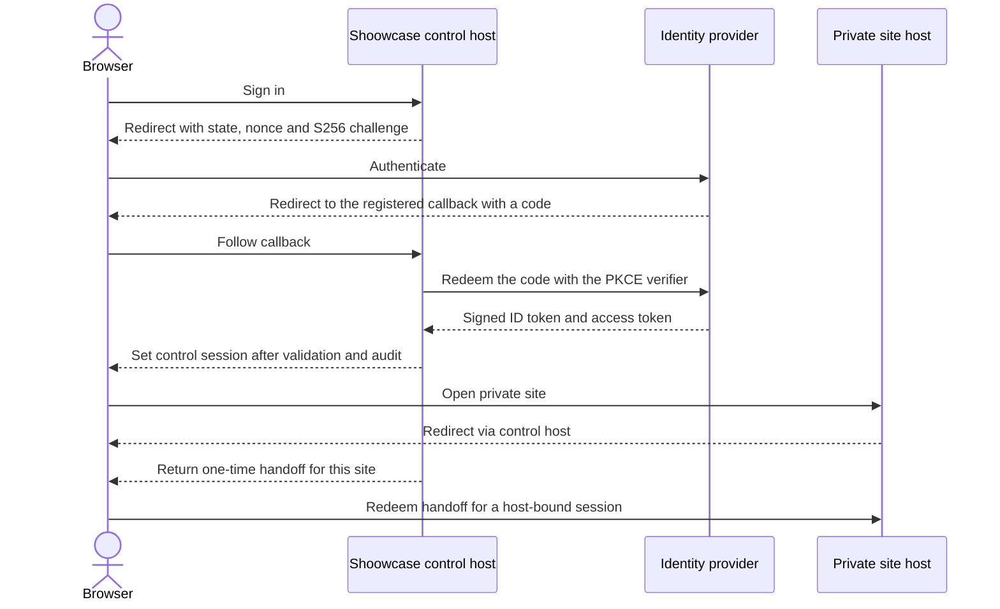

# Work sign-in with OIDC

## Register the browser client

Use the authorization code flow with **PKCE S256**. Register exactly `https://<control-host>/auth/callback` as a GET redirect. Sites and previews use a one-time handoff from the control host; their hostnames do not belong in the provider's redirect allowlist.

Set `SHOOWCASE_ISSUER` to the provider's exact HTTPS issuer, including its tenant path if applicable. The discovery document must advertise `S256` under `code_challenge_methods_supported`, and the authorization, token and JWKS endpoints must be direct HTTPS URLs. Shoowcase refuses to start if the provider cannot advertise this policy. Configure the provider to require S256 on this client. Shoowcase sends a fresh challenge on every authorization and sends the verifier only to the token endpoint.

Set `SHOOWCASE_CLIENT_ID` and choose the token endpoint authentication method registered for that client:

| Registration | Configuration |
| --- | --- |
| Confidential client | Supply `SHOOWCASE_CLIENT_SECRET` from the deployment secret store. With no explicit method, Shoowcase prefers `client_secret_basic`, and uses `client_secret_post` if basic is unavailable. If the provider advertises both, set `SHOOWCASE_CLIENT_AUTH_METHOD` to the method registered for this client. |
| Public client | Leave `SHOOWCASE_CLIENT_SECRET` empty. The provider must advertise `none`. Optionally set `SHOOWCASE_CLIENT_AUTH_METHOD=none`. |

Discovery without `token_endpoint_auth_methods_supported` defaults to `client_secret_basic`. The service never retries a code using a different authentication method. Providers that require private key JWT or mutual TLS client authentication are not supported.

## Configure claims

Use an immutable subject (`sub`) and stable workspace ID. A theme or friendly name belongs in the workspace settings, not the workspace claim. The database scopes memberships to workspace and subject and binds them to the configured issuer on the first production startup after migration. Later startups with another issuer fail. For an existing database, verify the original issuer *before* starting the upgraded binary. Development startup instead pins the database to a separate development namespace. This applies to both SQLite and PostgreSQL: a database bound for production cannot be served using synthetic development users, or vice versa. A legacy database cannot identify its original issuer: its first startup after upgrade binds it permanently, so use `-dev` only on a disposable copy. Changing identity provider requires a planned identity and membership migration.

By default an ID token must name exactly the browser client as its audience. If your provider also includes a project ID, set `SHOOWCASE_OIDC_PROJECT_AUDIENCE` (Helm: `config.oidc.projectAudience`) to that exact ID. The token may then carry both the browser client ID and that project ID, provided its authorized party (`azp`) is the browser client ID. Any other additional audience is rejected. Use a dedicated project if the issuer includes the IDs of other clients in the token. This option applies only to browser ID tokens; the MCP audience is configured separately. ID tokens must use RS256 or ES256. The service validates signature, issuer, expiry, issue time, nonce, tenant and role claims. If present, the authorized party (`azp`) must match the client, and the access token hash (`at_hash`) must match the returned access token. If discovery advertises RFC 9207 response issuer identification, the callback must contain the matching `iss`. A supplied `iss` must always match. Callback state is bound to the browser and consumed once across replicas.

The MCP endpoint is a separate resource. Configure `SHOOWCASE_AUDIENCE` with an audience distinct from the browser client ID. MCP OAuth clients use JWT access tokens with an access-token type (`at+jwt`), that audience and any required scope. Register those clients with the provider separately. Browser ID tokens are not MCP credentials. See [tenant access](tenant-access.md) for supported roles and local restrictions.

## Use OIDC alongside password accounts

To offer both methods on the same sign-in page, set `SHOOWCASE_LOCAL_WORKSPACE` to the workspace that will own the password accounts. Leave `SHOOWCASE_PUBLIC_REGISTRATION=false` for an invitation-only password directory. An administrator can still create accounts under **Workspace admin**. See [tenant access](tenant-access.md#manage-password-accounts) for the member workflow.

Optionally set both `SHOOWCASE_OIDC_ADMIN_SUBJECT` and `SHOOWCASE_OIDC_ADMIN_WORKSPACE`. The former is the immutable `sub` for this client at the configured issuer. After normal OIDC token verification, this one subject maps to admin in the specified workspace even when the issuer omits Shoowcase-specific role or workspace claims. Its first successful browser sign-in creates its membership. Other subjects still need the configured claims. The `local:` subject prefix is reserved for generated password-account IDs. A matching email address, display name or password login never links to an OIDC identity.

## Sessions and rollout

Every replica needs the same session key and database. Cookie encryption binds a browser session, sign-in and handoff to its issuer, client, claim mapping and hosts. After this upgrade, or after changing the issuer, client ID, claim mapping, API audience, scope or hosts, users must sign in again and request new action links. Stop old replicas before the migration. Verify a synthetic account can reach a private site through two replicas, then sign out in the control workspace and retry the site.

Shoowcase sign-out revokes the current sign-in, including any derived content-host sessions and unfinished site handoffs. Existing cookies and handoffs fail closed if the shared revocation store cannot be consulted. If sign-out returns HTTP 503, the browser keeps its session cookie so you can retry from the same host. Retry after the service recovers: the session and its derived cookies may still work until sign-out succeeds or they expire. A successful sign-out clears the local cookie.

The provider's own single-sign-on session, other independent browser sign-ins and personal keys have separate lifetimes. Browser sessions expire within 15 minutes or when the ID token expires, whichever comes first. Signing out only at the provider does not notify Shoowcase.

Successful control sign-ins and the first logout on either a control or content host record the verified subject, workspace and event type in the tenant's audit history. The service records the logout and revokes the family together in one database transaction; repeated submissions do not duplicate the audit entry. If a login cannot be recorded, the service returns 503 without issuing a session. Malformed callbacks have no trusted tenant; rejection warnings are limited to one per minute per replica, with only a fixed reason. Configure ingress to omit query strings and headers from access logs.
