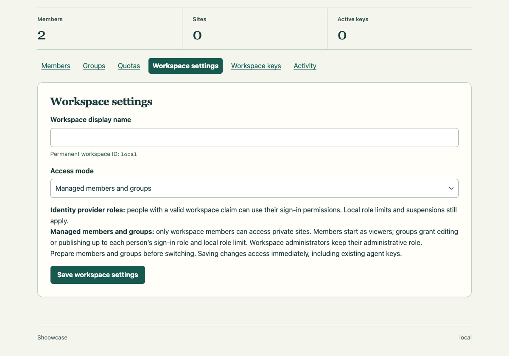
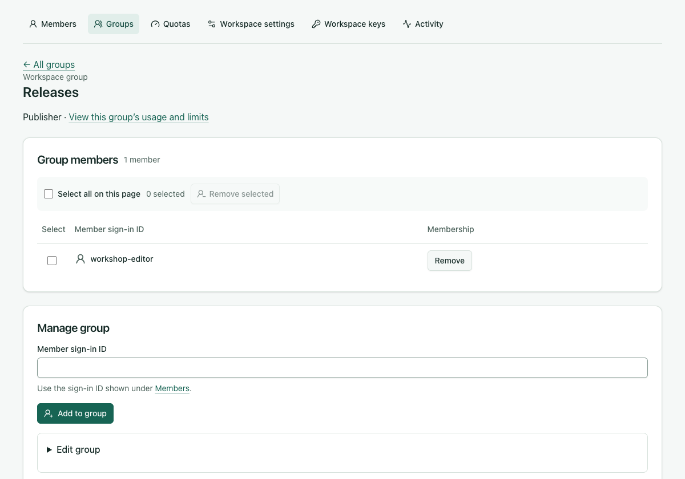
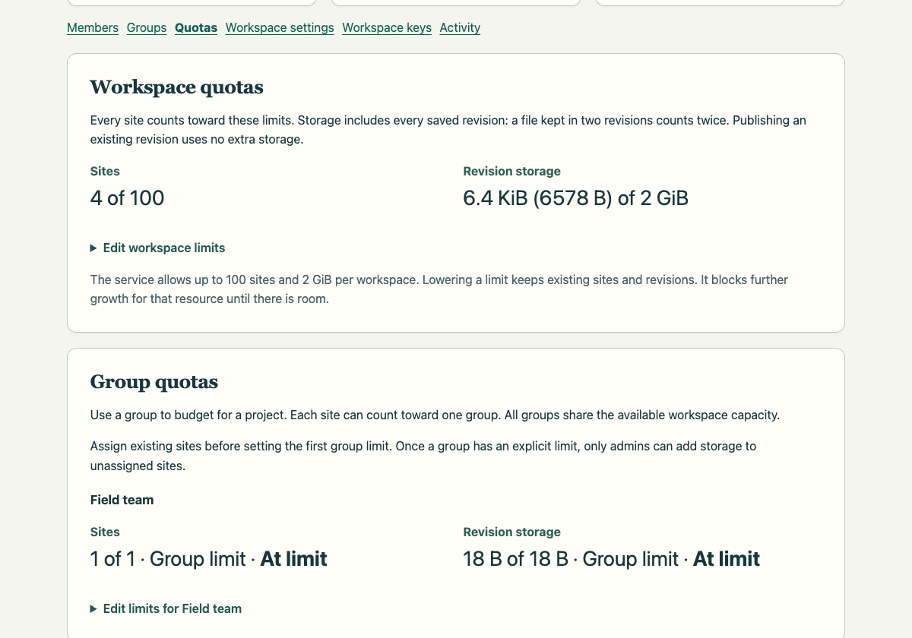

# Tenant access

A workspace is one tenant. Its ID comes from the signed workspace claim; a form, site ID or group ID cannot select another workspace. The database is bound to one identity issuer. The same subject in two workspaces has separate memberships, keys and group assignments. Changing a workspace’s display name leaves its identity and URLs unchanged.

## Choose how access is granted

Open **Workspace admin → Workspace settings** as an enrolled identity-provider administrator.

| Access mode | Who can access the workspace? | Role |
| --- | --- | --- |
| Identity (default) | People with a valid workspace claim. MCP and private delivery permit unenrolled identities. The console and personal keys require a local account. | Signed identity-provider role, capped by any individual role limit. Groups do not grant a higher role; membership determines which project budgets an editor can use. |
| Managed | Active local members. An administrator provisions each person by their exact OIDC subject. Only a user with a verified administrator role may self-enroll. | Members start as readers. The strongest group role applies, capped by the current identity-provider role and any individual limit. An enrolled identity-provider administrator retains admin access. |

In either mode a suspended account is denied private access. An intentionally public live release remains accessible anonymously, subject to the instance-wide public sharing setting.

## Set up a managed tenant

1. Sign in with a workspace administrator account and complete enrollment. The identity provider owns the workspace ID and administrator role.
2. Under **Members**, provision the exact OIDC subject and a display name. Choose the stable subject issued to Shoowcase, not a login alias or email address unless it actually is the subject. Provisioning alone does not create an identity or credentials. A signed-in person who needs provisioning sees **Workspace access required** and their exact sign-in ID on the console. After you add them, they can reload the original page.
3. Under **Groups**, create groups, assign each a role, then add members. An Authors group might have editor rights; a Release team might have publisher rights. A member of both can publish only if the identity provider also permits publication.
4. Review all existing members, groups, keys and the current admin before switching to managed mode. Existing accounts stay enrolled. An existing publisher without a group becomes a reader immediately. A user who previously only used an IdP access token needs to be provisioned.
5. Save the managed setting, then verify one reader, one editor and one publisher against a private test site. The **Members** view shows effective roles. Switch back to identity mode only if returning access to all signed workspace identities is intended.

| Role | Permissions |
| --- | --- |
| Reader | List sites, inspect revisions and read private previews and workspace releases. |
| Editor | Reader permissions plus creating sites and changing drafts. |
| Publisher | Editor permissions plus publishing, rolling back and changing visibility. Public changes still require browser approval. |
| Administrator | Publisher permissions plus member, group, workspace and audit administration. This role cannot be granted by a group or personal key. |

Group roles apply across the workspace. Group budgets restrict draft edits; private viewing and publishing still use workspace roles. There are no nested groups. Each workspace supports 2,000 member records and 128 groups. An account’s IdP role follows its most recently verified assertion; live IdP directory changes are observed on sign-in or token use. For immediate local offboarding, suspend the member. This also revokes their personal keys. Restoring an account does not reactivate those keys.

After a group removal, role change or switch to managed mode, Shoowcase rechecks existing key and signed action permissions at use. Admin mutations check current membership under the same database lock as the write. If two admins edit the same group or settings, the stale form reports a conflict; reload before retrying.

## Set project budgets

Use one group per project that needs a budget. In **Workspace admin → Quotas**, set the maximum number of sites and the maximum revision storage for the workspace. The defaults and service ceilings are 100 sites and 2 GiB. You can also cap either resource for a group. A blank group limit uses the shared workspace capacity; a zero denies additional use of that resource. Group limits do not reserve space.

1. Under **Groups**, give project authors an editor or publisher group membership. They also need editing rights from their sign-in or key. Group membership determines which project budget a writer can spend in either access mode.
2. Under **Quotas → Site assignments**, assign existing project sites before setting the first group limit. All retained revisions move with the site. The new group must have room for both the site and its history. The address, release, and audience stay the same. Move sites out of a group before deleting it.
3. Set the group limits. For example, a group limited to **5 sites / 250 MiB** can use at most those amounts, and only as much space as remains in the workspace. Inspect **Quotas** to see actual usage and **Activity** to review changes.
4. On **New site**, choosing a group is optional until the first group limit is set. After that, an editor with one eligible group gets it automatically; editors with several choose one. MCP clients can call `list_site_groups` and pass the returned ID in `create_site.group_id`. Editing an assigned draft requires an editor or publisher membership in that group, or workspace administrator rights. Once any group has an explicit limit, only administrators may create unassigned sites or add storage to them.

**What counts as storage?** A 6 MiB draft followed by a 7 MiB revision consumes 13 MiB, even if both use some of the same files. Site creation adds one site and an empty revision; publishing, reading or restoring an existing release adds no storage. Lowering a limit below current use preserves existing content. Only operations that add to the exhausted resource are refused.

## Database upgrade

Stop and drain older writers before upgrading. Schema 4 retains existing sites, groups and access settings. Existing sites start unassigned, with their revision storage already counted, and workspaces keep the previous 100-site and 2-GiB ceilings. Workspaces upgrading from before schema 3 start in identity mode. Keep a restorable pre-upgrade backup; earlier binaries cannot write schema 4.
