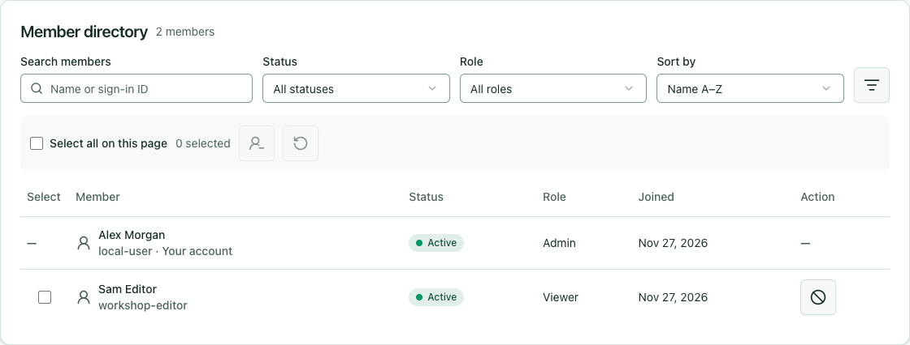

# Tenant access

A workspace is one tenant. Its ID comes from the signed workspace claim or the operator’s fixed workspace mapping; a form, site ID or group ID cannot select another workspace. The database is bound to one identity issuer. The same subject in two workspaces has separate memberships, keys and group assignments. Changing a workspace’s display name leaves its identity and URLs unchanged.

## Choose how access is granted

Open **Workspace admin → Workspace settings** as a workspace administrator.

| Access mode | Who can access the workspace? | Role |
| --- | --- | --- |
| Identity (default) | People with a valid workspace claim and locally provisioned password accounts. MCP and private delivery permit unenrolled identities. The console and personal keys require a local account. | The sign-in role comes from the identity provider for SSO or from the password account for local sign-in. An individual role limit can reduce access. Groups do not grant a higher role; membership determines which project budgets an editor can use. |
| Managed | Active workspace members. An administrator provisions an OIDC subject or creates a password account. Only a user with a verified administrator role may self-enroll. | Non-admin members start as viewers. Their strongest group grant applies up to their sign-in role and any individual limit. Members with the Admin sign-in role do not need a group grant. An individual role limit still applies. |

In either mode a suspended account is denied private access. An intentionally public live release remains accessible anonymously, subject to the instance-wide public sharing setting.

## Find a site

**Sites** and the MCP tool `list_sites` show sites you created and sites assigned to a group you currently belong to. Any group role counts, including reader. If you leave a group, its sites drop out of your list unless you created them. The same rule applies to administrators; open **Workspace admin → All sites** to see every site in the workspace, including unassigned sites.

Directory membership does not change a site's audience. Someone with a direct link can still open it if its existing access settings allow them to.

## Find a member or group

Open **Workspace admin → Members** to search by display name or sign-in ID. You can filter by active or suspended status and effective role, and sort by name or sign-in ID. Select someone’s name to manage access, set a role limit or change a password account’s sign-in role. Your own name opens **Account**.

Under **Groups**, search by name, filter by group role, or sort by member count. Select a group to see its members, change its role, or manage membership. On a small screen, **Filter and sort** opens the additional options in either directory.

To act on one row, use its **Suspend**, **Restore**, **Delete** or **Remove** button. For several entries, check their rows and choose the action for the selection. **Select all on this page** covers the displayed rows only. The review lists every target before anything changes; if a target changes in the meantime, reopen the directory and review again.

Suspending a member keeps the account record, blocks workspace access, ends their local password sessions and revokes their agent keys. Restoring access does not restore revoked keys. Administrators cannot suspend themselves. Removing a person from a group only removes that membership. Deleting a group removes its grants; if any selected group still has an assigned site, the entire deletion is refused.

### Permanently delete an account

In **Workspace admin → Members**, choose **Delete account** on a row or select several members and choose **Delete selected accounts**. Review the sign-in IDs and site addresses. **Permanently delete accounts** removes the selected accounts, their passwords, keys, memberships, request history, and every site they created in this workspace. Published sites and previews stop serving immediately; drafts, files, releases and changes other members made to those sites are removed together. Sites created by other people remain, including their content and edits. You cannot delete yourself.

The active database removes audit entries identifying the deleted account or its sites. The workspace records who performed the deletion without naming the deleted member. Deleted site addresses stay reserved. Previously exported files, audit logs and backups are separate copies; existing backups expire under the operator's retention policy.

Deleting an OIDC account leaves the identity at the provider unchanged. Shoowcase keeps a workspace-specific digest to prevent existing sessions, tokens or a new sign-in from regaining access. An admin can explicitly provision that subject again; it starts empty and requires a fresh sign-in. If the account was just deleted, allow one minute for identity-provider clock differences before signing in again. A password username can be reused for a new, independent account.

## Set up a managed tenant

1. For initial setup, sign in with an administrator granted access by the identity provider or configured OIDC subject mapping, then complete enrollment. An existing administrator can also promote a password account.
2. Under **Members**, provision the exact OIDC subject and a display name. Choose the stable subject issued to Shoowcase, not a login alias or email address unless it actually is the subject. Provisioning alone does not create an identity or credentials. A signed-in person who needs provisioning sees **Workspace access required** and their exact sign-in ID on the console. After you add them, they can reload the original page.
3. Under **Groups**, create groups, assign each a role, then add members. An Authors group might have editor rights; a Release team might have publisher rights. A member of both can publish if their sign-in role and individual role limit allow it.
4. Review all existing members, groups, keys and the current admin before switching to managed mode. Existing accounts stay enrolled. An existing publisher without a group becomes a reader immediately. A user who previously only used an IdP access token needs to be provisioned.
5. Save the managed setting, then verify one reader, one editor and one publisher against a private test site. The **Members** view shows effective roles. Switch back to identity mode only if returning access to all signed workspace identities is intended.

| Role | Permissions |
| --- | --- |
| Reader | List sites, inspect revisions and read private previews and workspace releases. |
| Editor | Reader permissions plus creating sites and changing drafts. |
| Publisher | Editor permissions plus publishing, rolling back and changing visibility. A publisher can complete public changes over MCP or in the browser. |
| Administrator | Publisher permissions plus member, group, workspace and audit administration. This role cannot be granted by a group or personal key. |

Group roles apply across the workspace. Group budgets restrict draft edits; private viewing and publishing still use workspace roles. There are no nested groups. Each workspace supports 2,000 member records and 128 groups. An account’s IdP role follows its most recently verified assertion; live IdP directory changes are observed on sign-in or token use. For immediate local offboarding, suspend the member. This also revokes their personal keys. Restoring an account does not reactivate those keys.

After a group removal, role change or switch to managed mode, Shoowcase rechecks existing key and signed action permissions at use. Admin mutations check current membership under the same database lock as the write. If two admins edit the same group or settings, the stale form reports a conflict; reload before retrying.

## Manage password accounts

When an operator enables password sign-in for this workspace, open **Workspace admin** to create an account. Enter a username and an initial password, choose Viewer, Editor or Publisher, and give the credentials privately to the new member. Usernames are case insensitive and use 3–64 letters (A–Z), digits, periods, underscores or hyphens, starting with a letter or digit. Passwords need at least 12 characters and may contain spaces.

On the sign-in page the member chooses the username and password form. A password sign-in lasts up to 30 days. Under **Account → Change password**, they enter the current and new passwords. After a change, they sign in again; their previous browser sessions no longer work. Personal agent keys are managed separately under **Agent keys**. Suspending a password account revokes its keys and sessions. Re-enabling it lets the member sign in again.

An administrator can create password accounts with public registration turned off. If the operator explicitly opens public registration, visitors can create reader accounts. Managed workspaces always require an administrator to add the member. The local username belongs only to its workspace. OIDC users change their passwords at the identity provider; **Account → Change password at identity provider** takes them there when the operator has [configured the link](oidc.md#use-oidc-alongside-password-accounts).

### Change a password account’s role

1. Sign in as a workspace administrator and open **Admin → Members**. Select another member who signs in with a local password.
2. Under **Sign-in role**, select **Viewer**, **Editor**, **Publisher** or **Admin**. Choose **Save sign-in role**. An administrator can also demote another local Admin here. You cannot change your own role.
3. Ask the member to sign in again. Changing the role ends their existing password sessions. The password stays the same, and **Admin → Activity** records the change.

The account role is the most this member can do. **Role limit** is a separate setting: changing the account role preserves it. For example, promoting a password account to Admin while its limit is Editor leaves its effective access at Editor. To grant full administrator access, also set the limit to **Use sign-in role**. In managed mode, non-admin accounts still need the corresponding group grant to edit or publish. Existing keys keep their own scopes, can never exceed their owner’s effective access, and cannot administer a workspace.

For an SSO account, the identity provider sets the highest role available. Under **Role limit**, select a lower role and choose **Save role limit**. This also works for another member whose provider grants Admin. Select **Use sign-in role** to remove the limit. For example, an SSO Editor can be limited to Viewer and restored to Editor; only the identity provider can grant that person Publisher or Admin.

## Set project budgets

Use one group per project that needs a budget. In **Workspace admin → Quotas**, set the maximum number of sites and the maximum revision storage for the workspace. The defaults and service ceilings are 100 sites and 2 GiB. You can also cap either resource for a group. A blank group limit uses the shared workspace capacity; a zero denies additional use of that resource. Group limits do not reserve space.

1. Under **Groups**, give project authors an editor or publisher group membership. They also need editing rights from their sign-in or key. Group membership determines which project budget a writer can spend in either access mode.
2. Under **Quotas → Site assignments**, assign existing project sites before setting the first group limit. All retained revisions move with the site. The new group must have room for both the site and its history. The address, release, and audience stay the same. Move sites out of a group before deleting it.
3. Set the group limits. For example, a group limited to **5 sites / 250 MiB** can use at most those amounts, and only as much space as remains in the workspace. Inspect **Quotas** to see actual usage and **Activity** to review changes.
4. On **New site**, choosing a group is optional until the first group limit is set. After that, an editor with one eligible group gets it automatically; editors with several choose one. MCP clients can call `list_site_groups` and pass the returned ID in `create_site.group_id`. Editing an assigned draft requires an editor or publisher membership in that group, or workspace administrator rights. Once any group has an explicit limit, only administrators may create unassigned sites or add storage to them.

**What counts as storage?** A 6 MiB draft followed by a 7 MiB revision consumes 13 MiB, even if both use some of the same files. Site creation adds one site and an empty revision; publishing, reading or restoring an existing release adds no storage. Lowering a limit below current use preserves existing content. Only operations that add to the exhausted resource are refused.

## Work with several rows at once

Check individual rows, or choose **Select all on this page**. The count shows how many entries are selected. Filtering or moving to another page starts a new selection. On the review screen, check the names before confirming; **Cancel** leaves them unchanged.

- In **Agent keys**, revoke one key or several. The workspace key list gives administrators the same controls for other members’ keys.
- In **Quotas**, **Clear limits** makes a group inherit the workspace limits. **Remove assignment** removes a site's group and can change who may edit it. Neither action deletes a site, group, or revision.
- In **Activity**, download the selected audit rows as a CSV. Audit entries and published release history are read-only.

## Database upgrade

Stop and drain older writers before upgrading. Schema 5 adds local credentials while preserving OIDC accounts. Schema 4 retains existing sites, groups and access settings. Existing sites start unassigned, with their revision storage already counted, and workspaces keep the previous 100-site and 2-GiB ceilings. Workspaces upgrading from before schema 3 start in identity mode. Keep a restorable pre-upgrade backup; a binary built for an older schema refuses to open an upgraded database. See the [schema 9 upgrade instructions](operations.md#upgrade-to-schema-9).
